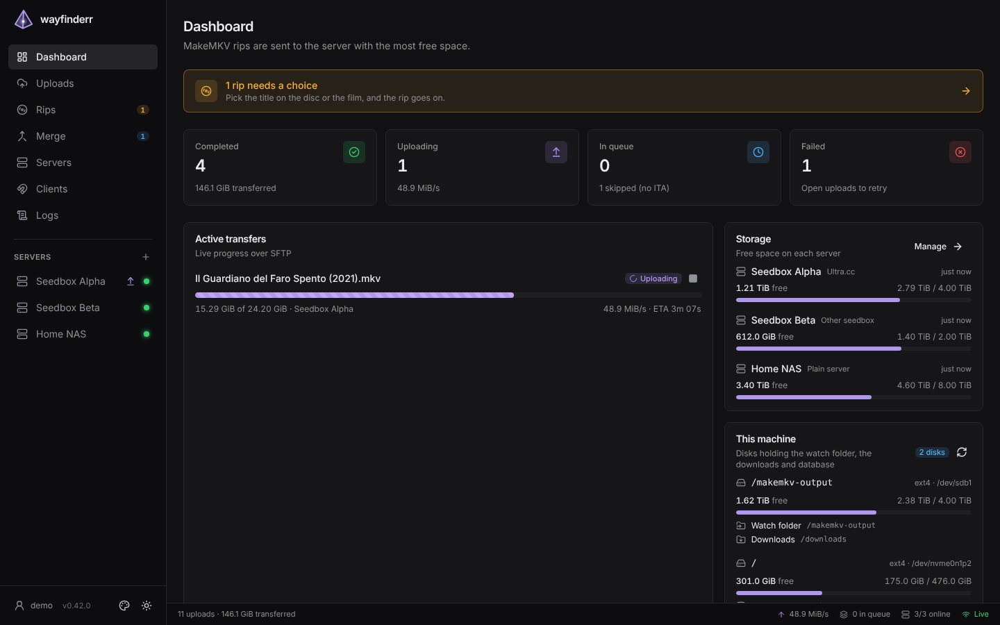
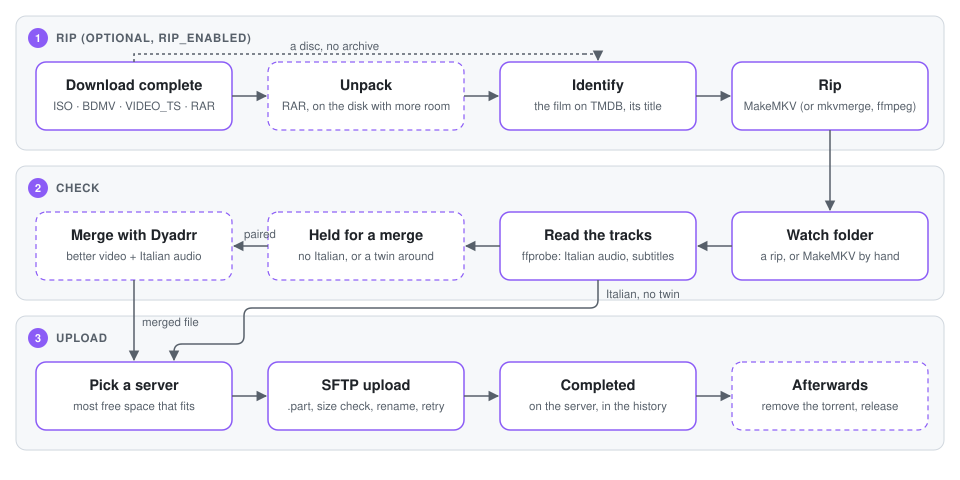
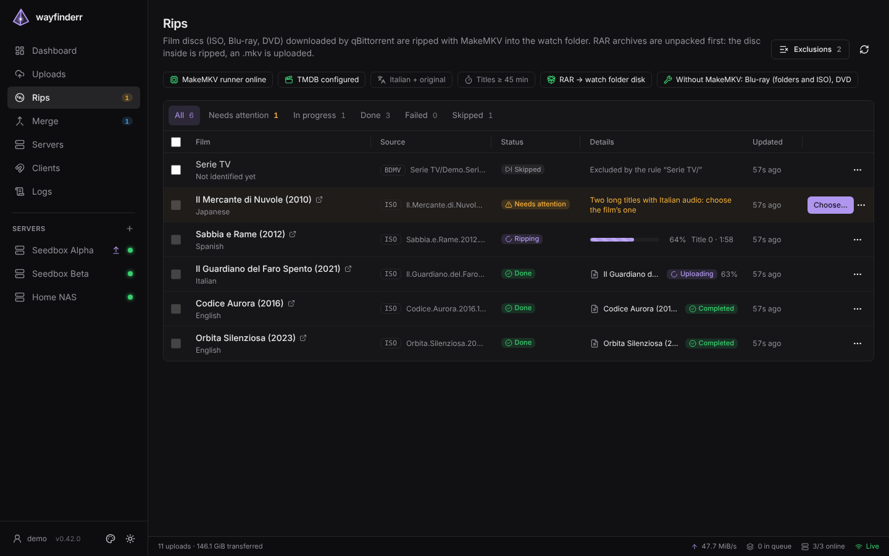
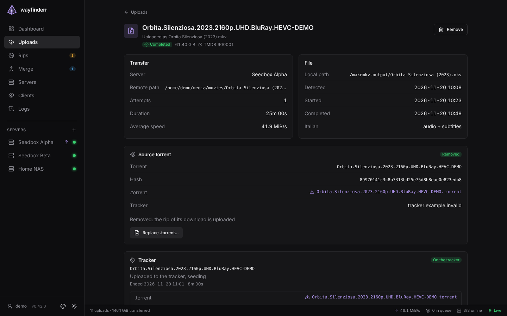
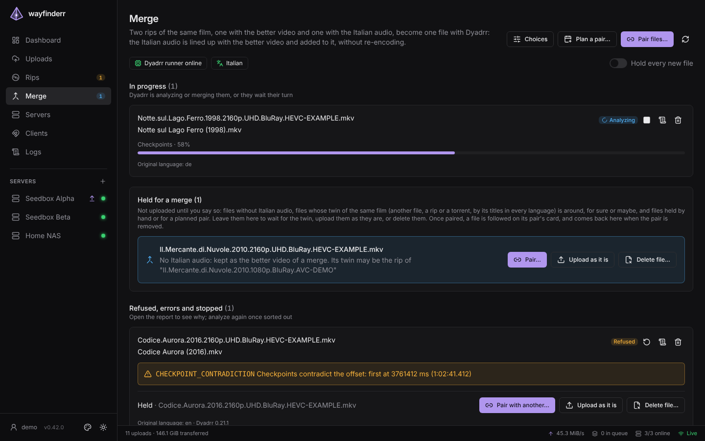
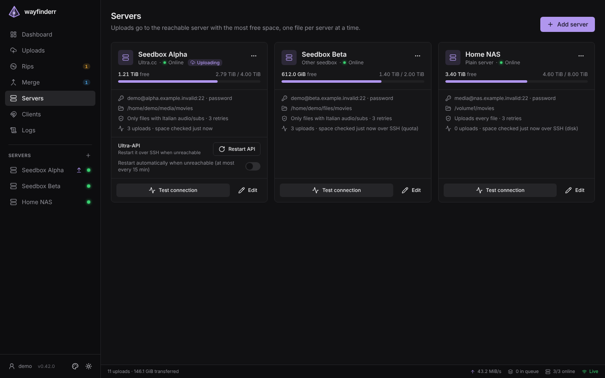

<p align="center">
  
</p>

<h1 align="center">Wayfinderr</h1>

<p align="center">
  Rips your film discs, checks the Italian tracks and uploads every MKV to the server with the most free space.
</p>

<p align="center">
  
  <a href="https://github.com/TehMaat/wayfinderr/actions/workflows/docker-publish.yml"></a>
  
  <a href="LICENSE"></a>
</p>

> [!NOTE]
> **Full Vibe Coded.** Wayfinderr is written entirely with AI coding assistants, from the first line
> of code to this README. Read the code, try it on your own setup, and keep backups.

<picture>
  <source media="(prefers-color-scheme: light)" srcset="docs/assets/screenshots/dashboard-light.png">
  
</picture>

## What it does

Wayfinderr watches the folder where MakeMKV saves its `.mkv` files. Every new file is checked for
Italian audio and subtitles (ffprobe) and uploaded over SFTP to the server with the most free
space, with retries. Optionally it also rips the film discs that finish downloading, removes the
source torrent from qBittorrent, releases the file on a tracker and merges two rips of the same
film.



**Stack**: Node.js 20 · Express · Prisma + SQLite · Next.js 14 · WebSocket · Docker Compose (optional)

## Features

- 🎯 **Smart server choice**: the server with the most free space that can hold the file. Ultra.cc slots (Ultra-API, or SSH while it is down), other seedboxes and plain SSH servers (account quota, else the disk, over SSH)
- 🔍 **Media check**: Italian audio and subtitles read with ffprobe; a per-server policy skips files without them
- 📤 **Reliable transfers**: SFTP to a temporary `.part` file, size check, rename; retries with backoff; unfinished uploads resume after a restart
- 📊 **Live dashboard**: progress, speed and time left over WebSocket; free space of every server and of the local disks
- 💿 **Automatic ripping**: discs (ISO, Blu-ray, DVD, also inside RAR archives) identified on TMDB and ripped with MakeMKV, Italian + original language; anything unsure waits for a choice. Unencrypted discs can be ripped without MakeMKV (mkvmerge, ffmpeg)
- 🧲 **Torrent cleanup**: once uploaded, the source torrent is found (its download, or names and TMDB titles in every language) and removed from qBittorrent
- 🏷️ **Tracker release**: rename on the server and run your tracker upload command in `tmux`, following its output; or release locally from the qBittorrent machine
- 🔀 **Merge** (in progress): two rips of a film, better video and Italian audio, merged by [Dyadrr](https://github.com/TehMaat/dyadrr) without re-encoding
- 🔐 **Login**: one account, sessions, API key for scripts; one reverse proxy entry is enough
- 🔒 **Built-in HTTPS**: the frontend serves HTTPS itself, no other container, with a Let's Encrypt certificate renewed by itself when Let's Encrypt says (or one copied in), taken up without a restart
- 🌗 **Dark and light theme**, five accent colors

## Screenshots

| | |
|---|---|
|  **Rips**: discs found in the downloads, ripped or waiting for a choice |  **Upload details**: transfer, media info, source torrent, release |
|  **Merge**: files held for a merge, pairs being analyzed |  **Servers**: free space, type and status of every server |

All screenshots use made-up data. More in the [User guide](docs/USAGE.md).

## Quick start

With Docker Compose and the prebuilt images:

```bash
git clone https://github.com/TehMaat/wayfinderr.git
cd wayfinderr
cp .env.example .env        # set MAKEMKV_OUTPUT_DIR (and WATCH_USE_POLLING=true on Windows/macOS)
docker compose up -d
```

1. Open http://localhost:3000.
2. Create the account with the setup code from `docker compose logs wayfinderr-backend | grep "setup code"`.
3. **Servers** → **Add server** → **Test**.

Every new `.mkv` in the watch folder is then uploaded. Other ways to install it (built from
source, local run on Windows without Docker), MakeMKV and Dyadrr in Docker, updates:
**[Installation](docs/INSTALLATION.md)**.

## Documentation

| | |
|---|---|
| [Installation](docs/INSTALLATION.md) | Docker Compose, local run, first account and server |
| [Configuration](docs/CONFIGURATION.md) | Every environment variable with its default |
| [User guide](docs/USAGE.md) | Every page and feature, with screenshots |
| [Deployment](docs/DEPLOYMENT.md) | Built-in HTTPS or a reverse proxy, backups, logs, updates |
| [Troubleshooting](docs/TROUBLESHOOTING.md) | Common problems |
| [Architecture](docs/ARCHITECTURE.md) | How it is built |
| [API](docs/API.md) | HTTP endpoints and WebSocket events |
| [Development](docs/DEVELOPMENT.md) | Checks, screenshots, diagrams, branches |
| [Changelog](docs/CHANGELOG.md) | What changed in every version |

## Contributing

Contributions are welcome: see [CONTRIBUTING.md](CONTRIBUTING.md). Every pull request updates the
documentation and the screenshots it touches, and raises the version.

## License

MIT: see [LICENSE](LICENSE).
