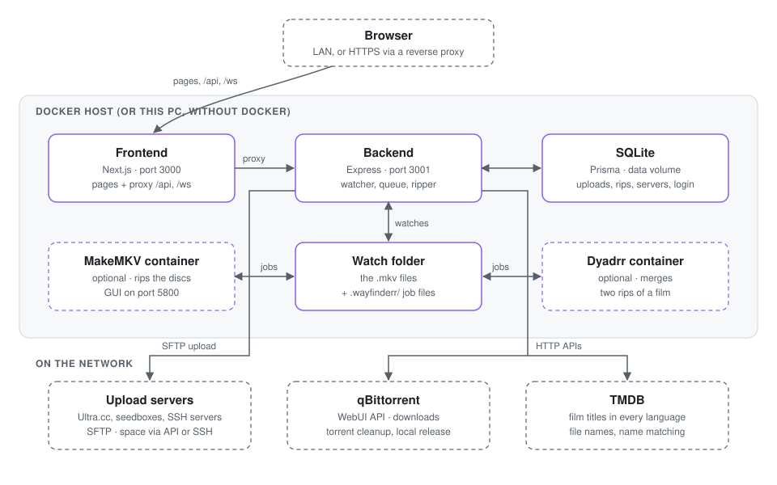
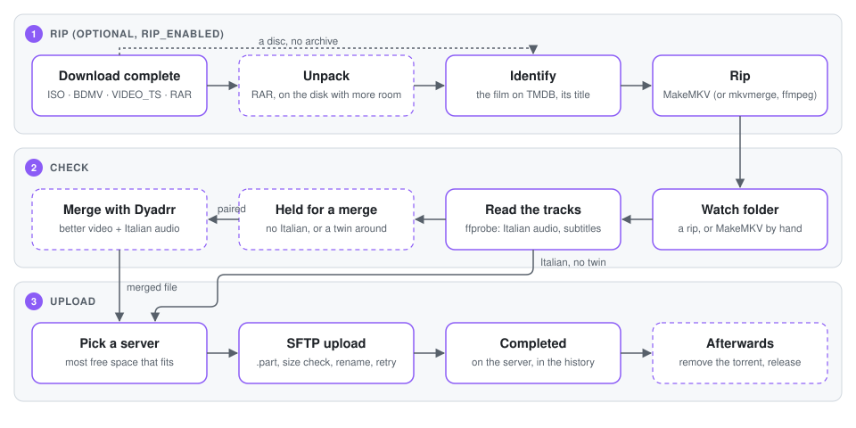

# Architecture

How Wayfinderr is built: the pieces, how a file goes through them, the data and the security model.
For the HTTP API see [API.md](API.md).



## Components

| Piece | Technology | Role |
|---|---|---|
| **Frontend** | Next.js 14, React, Tailwind, Zustand | The web UI, and a same-origin proxy: `/api`, `/health` and the `/ws` WebSocket go to the backend (`next.config.js` rewrites, `BACKEND_URL` compiled in). The only container with published ports |
| **Built-in HTTPS** (optional) | Node.js `https`, in the frontend container (`server.js`, `https/`) | With `HTTPS_DOMAIN`: TLS on 443 with the certificate of the `wayfinderr-certs` volume (reloaded when it changes), the redirect on 80, and the requests and the WebSocket forwarded to Next.js on 3000 with `X-Forwarded-*` set from the connection ([Deployment](DEPLOYMENT.md#built-in-https)) |
| **Let's Encrypt** (optional) | `acme-client`, in the frontend (`https/acme.js`) | With `HTTPS_CERT_SOURCE=acme`: gets the certificate of `HTTPS_DOMAIN` (HTTP-01, answered on port 80) and renews it in the window Let's Encrypt gives (ARI, RFC 9773), else at a third of its life; writes it in the `wayfinderr-certs` volume, taken up without a restart ([Deployment](DEPLOYMENT.md#lets-encrypt)) |
| **Certificate from Pangolin** (optional) | the backend, `ssh2` (`services/https`) | With `HTTPS_CERT_SSH_HOST`: fetches the wildcard Pangolin keeps on its host over SSH, through a command that prints that certificate only, and writes it in the `wayfinderr-certs` volume for the frontend; at start and every 6 hours ([Deployment](DEPLOYMENT.md#wildcard-from-pangolin)) |
| **Backend** | Node.js 20+, Express, `ws`, Prisma | Watches the watch folder, reads the tracks (ffprobe), queues and runs the uploads (SFTP), rips, merges, torrent cleanup, releases; REST API and live events |
| **Database** | SQLite (Prisma, migrations in `backend/prisma/migrations`) | Servers, uploads, rips, clients, merge pairs, settings, the login account. In the `wayfinderr-data` volume |
| **MakeMKV container** (optional) | jlesage/makemkv + a shell runner | Rips the discs. Shares the watch folder with the backend: the backend writes a job file in `<watch folder>/.wayfinderr`, the runner claims it, runs `makemkvcon` and writes back its progress and result |
| **Dyadrr container** (optional) | [Dyadrr](https://github.com/TehMaat/dyadrr) | Analyzes and merges two rips of a film. Same file-job protocol, in `<watch folder>/.wayfinderr/dyadrr/jobs` ([Dyadrr's CONTAINER.md](https://github.com/TehMaat/dyadrr/blob/main/docs/CONTAINER.md)) |

The backend never calls the two containers over the network: they only share the watch folder, and
each one writes an `alive` file there so the UI can tell whether it is running. The browser only
talks to the frontend, so a reverse proxy needs a single entry, and the built-in HTTPS sits in the
frontend container: `server.js` starts `next start` and, with `HTTPS_DOMAIN`, HTTPS in front of it.

## How a file goes through it



1. **Detection** (`services/fileWatcher.ts`): chokidar watches the watch folder, subfolders
   included; a file counts once its size has been stable for 30 seconds. A rescan every 30 seconds
   catches what the watcher misses (Docker Desktop, network shares).
2. **Media info** (`services/mediaInfo.ts`): ffprobe reads every video, audio and subtitle track;
   the upload records whether there is Italian audio or subtitles.
3. **Hold for a merge** (`services/merge/hold.ts`, only with `MERGE_ENABLED`): a file without
   Italian audio, or with a twin of the same film around (a held file, a rip not done, a torrent of
   the clients, matched by every TMDB title), is held instead of queued.
4. **Server choice** (`services/serverManager.ts`): the free space of every server (Ultra-API for
   Ultra.cc, else over SSH: the account quota or the disk; cached 60 seconds); the reachable server
   with the most free space that can hold the file and is not busy gets it. Its media policy can
   skip a file without Italian.
5. **Upload** (`services/jobQueue.ts`, `services/uploadManager.ts`): SFTP into `<name>.part`, size
   check, rename. On error, up to the server's retries (3) with backoff: exponential 5 s, 10 s, 20 s…
   or linear 10 s, 20 s, 30 s. Uploads unfinished at a stop resume at the next start.
6. **Afterwards**: the source torrent is matched and removed (`services/torrentCleanup.ts`), and
   the file can be released on the tracker (`services/release`).

Every step broadcasts an event on the WebSocket (`upload-started`, `progress`, `upload-completed`,
`rip-updated`, `merge-pair-progress`…): the UI updates without polling.

## Concurrency

- One upload queue (p-queue): at most `MAX_CONCURRENT_UPLOADS` (2) uploads at a time, and one per
  server; a file waits while every server that could hold it is busy.
- Rips run one at a time in the MakeMKV container; RAR unpacking, rips without MakeMKV and joins one
  at a time in the backend, between rips.
- One thing writes a film at a time: a merge waits for the rip, unpacking or join in progress, and
  the next rip waits for the merge.
- One tracker command at a time per server.

## Code layout

```
backend/
├── prisma/                   schema.prisma + migrations (applied at start in Docker)
└── src/
    ├── index.ts              Express app, WebSocket (/ws), start-up and shutdown
    ├── cli.ts                reset-auth (forgotten password)
    ├── config/               environment variables, pino logger
    ├── middleware/           cross-site guard, session / API key check
    ├── routes/               REST API: auth, servers, space, uploads, release, clients,
    │                         source-torrents, rips, merge, system, logs
    └── services/
        ├── fileWatcher.ts    the watch folder
        ├── mediaInfo.ts      ffprobe
        ├── serverManager.ts  server space (ultraApi.ts, sshSpace.ts, serverTypes.ts)
        ├── jobQueue.ts       the upload queue
        ├── uploadManager.ts  SFTP upload, retries
        ├── torrentCleanup.ts qBittorrent matching and removal (qbittorrent.ts, nameMatch.ts)
        ├── sourceTorrents.ts .torrent files sent beforehand (bookrr)
        ├── seeding.ts        released films: where they seed, their torrents never removed
        ├── spaceGuard.ts     pauses the torrents when this machine runs out of space
        ├── diskUsage.ts      the disks of this machine
        ├── filmLookup.ts     a film's TMDB titles in every language
        ├── auth.ts           account, sessions, setup code, API key (loginLimiter.ts)
        ├── database.ts       Prisma queries
        ├── ripper/           downloads scan, RAR, TMDB, title choice, MakeMKV jobs, remux, joins
        ├── merge/            holding, pairs, planned pairs, Dyadrr jobs
        ├── release/          release name, tracker command in tmux, its output and .torrent
        ├── logs/             log history on disk, retention, Dyadrr logs
        └── https/            the built-in HTTPS certificate fetched from Pangolin's host

frontend/
├── server.js                 starts next start, and the built-in HTTPS with HTTPS_DOMAIN
├── https/                    built-in HTTPS: settings, certificate checks, the proxy to Next.js,
│                             the redirect, reload on change, Let's Encrypt (acme.js; tests:
│                             node --test, against an ACME server of the test)
├── app/                      pages: dashboard, uploads (+ details), servers, rips, clients,
│                             merge (+ pair, report, logs), logs
├── components/               UI pieces (dialogs, tables, cards; ui/ = base components)
└── lib/                      API client, Zustand store, WebSocket hook, helpers

makemkv/                      the wayfinderr-makemkv image: jlesage/makemkv + the rip runner
scripts/                      Docker helpers, logos, screenshots of the docs, and
                              https/pangolin-cert-setup.sh (run on Pangolin's host)
```

## Data model

| Model | What it holds |
|---|---|
| `Server` | An upload server: type (`ULTRA`, `SEEDBOX`, `SSH`), SSH login, remote folder, Ultra-API, retries, media policy, release settings, cached free space |
| `Upload` | A file: path, size, media info, status (`PENDING`, `QUEUED`, `UPLOADING`, `COMPLETED`, `FAILED`, `SKIPPED`, `CANCELLED`, `HELD`, `MERGED`), progress, server, source torrent, release, hold reason |
| `Rip` | A disc or archive in the downloads: status (`WAITING` … `DONE`, `NEEDS_ATTENTION`, `FAILED`, `SKIPPED`), scanned titles, the chosen title and TMDB film, progress, the output file |
| `TorrentClient` | A qBittorrent client: WebUI login, category, removal rules, low-space pause, local release |
| `SourceTorrent` | A .torrent sent before its upload exists, kept for good |
| `MergePair` / `MergePlan` | Two files merged with Dyadrr (analysis, report, merge), and pairs planned before their files arrive |
| `Setting` | Key/value: the login account, the session key, rip exclusions, merge choices |

Full schema: [`backend/prisma/schema.prisma`](../backend/prisma/schema.prisma).

## Security

- **One account** (username + scrypt hash) in `Setting`. Until it exists every other `/api` route
  answers 401 `auth_setup_required`, and creating it takes the one-time setup code printed in the
  backend log (or `WAYFINDERR_SETUP_CODE`).
- **Sessions**: an HMAC-signed token in the HttpOnly, SameSite=Lax cookie `wayfinderr_session`
  (`Secure` on HTTPS, from `X-Forwarded-Proto`), valid 30 days. Changing the password or "sign out
  everywhere" invalidates every older session and closes their WebSockets.
- **API key** (`X-Api-Key`) for scripts and bookrr, regenerated from the account menu.
- A session or the key is needed for every `/api` route except `/api/auth`, and for `/ws`.
- **Cross-site requests** (unsafe methods and the WebSocket) are refused: `Sec-Fetch-Site`, else
  `Origin` against `X-Forwarded-Host`/`Host`.
- **Login limiter**: 5 failures per 15 minutes per client (`X-Forwarded-For` from the reverse proxy).
- **Built-in HTTPS**: the frontend is the first hop, so it drops the client's own `X-Forwarded-*`,
  `Forwarded` and `X-Real-IP` and sets `X-Forwarded-For`, `-Proto` and `-Host` from the connection;
  port 3000 is bound to `127.0.0.1`. A certificate is used only if it covers `HTTPS_DOMAIN`, matches
  its key and is in its dates. No HSTS. With Let's Encrypt, port 80 answers only the challenges of
  orders in progress; the account key stays in the volume.
- **Certificate from Pangolin**: Wayfinderr's SSH key (made at the first start, in the data volume)
  may only run, as `wayfinderr-cert` on Pangolin's host, the command that prints the wildcard
  (`restrict,command=…`, then a sudo rule for that command alone), never the rest of `acme.json`.
  The host key is checked: pinned by `HTTPS_CERT_SSH_HOST_KEY`, else kept at the first connection.
  The private key never goes to the log.
- **Secrets** (SSH passwords, API tokens, qBittorrent passwords) are stored in the database and never
  returned by the API (`hasSshPassword`, `hasApiToken`…); logs redact them.
- Database backups contain the password hash and the session key: keep them private.

## Limits

- One backend process and SQLite: fine for a home setup and tens of thousands of uploads, not meant
  to scale out.
- One Dyadrr container per watch folder.
