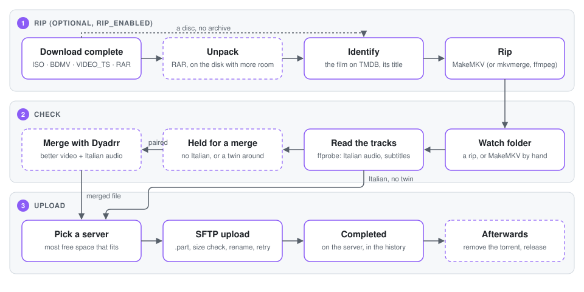

# Wayfinderr documentation

> **Full Vibe Coded**: Wayfinderr is written entirely with AI coding assistants, from the first
> line to these docs. Read the code, test it on your own setup, and keep backups.

| Page | What is in it |
|---|---|
| [Installation](INSTALLATION.md) | Docker Compose (prebuilt or from source), local run without Docker, first account, first server |
| [Configuration](CONFIGURATION.md) | Every environment variable, by service, with its default |
| [User guide](USAGE.md) | Every page and feature: uploads, servers, ripping, torrent cleanup, releases, merging, logs |
| [Deployment](DEPLOYMENT.md) | Reverse proxy and HTTPS, backups, logs, updates, security |
| [Troubleshooting](TROUBLESHOOTING.md) | Common problems and what to do |
| [Architecture](ARCHITECTURE.md) | Components, data flow, code layout, data model, security model |
| [API](API.md) | Every HTTP endpoint and WebSocket event |
| [Development](DEVELOPMENT.md) | Running from source, checks, screenshots, diagrams, branches |
| [Changelog](CHANGELOG.md) | What changed in every version |

The documentation and the screenshots are updated with every change to the code
([Development](DEVELOPMENT.md#documentation-and-screenshots)). Every name in them (films, torrents,
servers, trackers) is made up.
