# User guide

What every page of Wayfinderr does, and how to set up each feature. To install it first, see
[Installation](INSTALLATION.md); every setting is in [Configuration](CONFIGURATION.md).

> The screenshots show made-up data (films, servers, torrents): they are taken by
> `scripts/screenshots/run.mjs` from the real app, and taken again whenever the UI changes.

- [How it works](#how-it-works)
- [Create the account](#create-the-account)
- [Dashboard](#dashboard)
- [Uploads](#uploads)
- [Servers](#servers)
- [Automatic ripping](#automatic-ripping)
- [Remove the source torrent](#remove-the-source-torrent)
- [Source .torrent files from bookrr](#source-torrent-files-from-bookrr)
- [Release on the tracker](#release-on-the-tracker)
- [Release locally](#release-locally)
- [Merge with Dyadrr](#merge-with-dyadrr)
- [Logs](#logs)
- [Look and feel](#look-and-feel)

## How it works

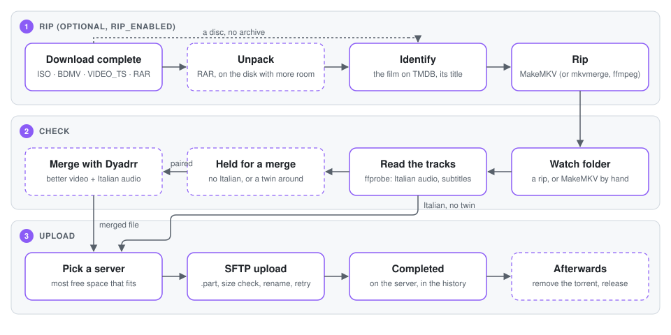

1. **Rip** (optional): a film disc (ISO, Blu-ray or DVD folder, or a RAR archive holding one) that finishes downloading is identified on TMDB and ripped with MakeMKV into the watch folder. MakeMKV used by hand saves there too.
2. **Check**: every new `.mkv` in the watch folder is read with ffprobe. With merging on, a file without Italian audio, or with a twin of the same film around, is held until you decide.
3. **Upload**: the server with the most free space that can hold the file gets it over SFTP, with retries. Then the source torrent can be removed from qBittorrent and the file released on the tracker.

## Create the account

Wayfinderr stays closed until its single account exists.

1. Open http://localhost:3000: the first visit shows the setup screen.
2. Copy the one-time **setup code** from the backend log: `docker compose logs wayfinderr-backend | grep "setup code"` (`docker logs wayfinderr-backend` if the container has that name; the backend terminal for a local run). To choose the code yourself, set `WAYFINDERR_SETUP_CODE` for the backend.
3. Choose a username and a password (at least 8 characters).

Anyone with the setup code can create the account: treat that log line as a secret, and create the account before exposing the app outside the LAN.

Sessions last 30 days (HttpOnly cookie). The account menu at the bottom of the sidebar (your username) has **Change password** (signs out every other device), **API key** (for bookrr and scripts, sent as `X-Api-Key`), **Sign out** and **Sign out everywhere**. After 5 failed attempts in 15 minutes, a client has to wait before trying again.

**Forgotten password**: delete the account, then reopen the page and create it again with the new setup code from the log (servers and history are kept):

```bash
docker compose exec wayfinderr-backend node dist/cli.js reset-auth   # or: docker exec wayfinderr-backend node dist/cli.js reset-auth
# local run: cd backend && npm run build && npm run reset-auth
```

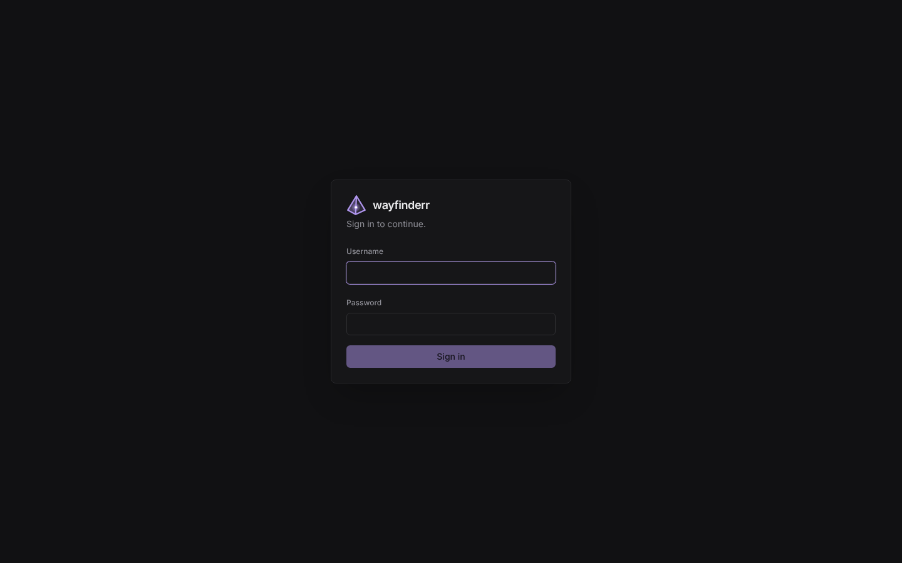

## Dashboard

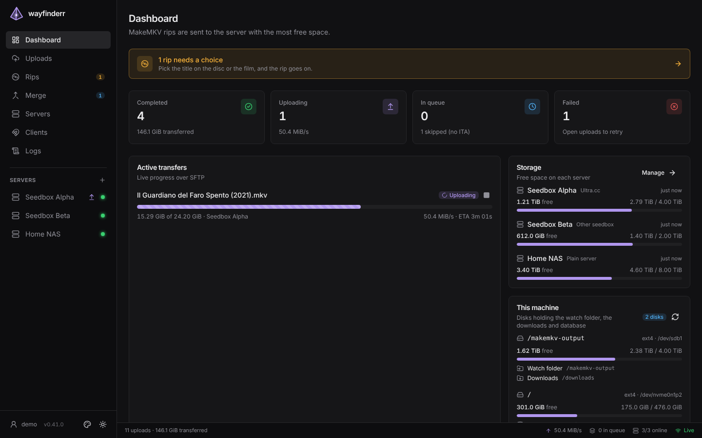

The first page: what is uploading now (progress, speed, time left), the counters (completed, uploading, queued, failed), the free space of every server and the disks of this machine (watch folder, downloads, database; one bar per disk). A banner shows the rips and merges waiting for a choice. The bar at the bottom shows the total speed, the queue, the servers online and whether live updates are connected.

## Uploads

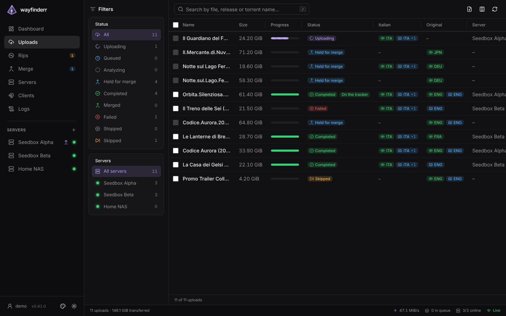

Every file Wayfinderr has seen, newest first: its status, size, server, Italian tracks, source torrent and release. Search by file, release or torrent name or hash; filter by status; pick the columns to show. Select several uploads to retry, stop or delete them together.

A file is picked up once its size has been stable for 30 seconds. The watch folder, subfolders included, is also rescanned every 30 seconds, so files the watcher misses (Docker Desktop, network shares) are still picked up within a minute or two. Up to `MAX_CONCURRENT_UPLOADS` uploads run at once, one per server. An upload is written to a temporary `.part` file, its size checked, then renamed; a failed one is retried with backoff, and the uploads unfinished when Wayfinderr stops resume at the next start. With `DELETE_AFTER_UPLOAD=true` the local file is deleted once it is on the server.

Open an upload for its details: the transfer, the file and its media info (video, every audio and subtitle track), the source torrent and the tracker release.

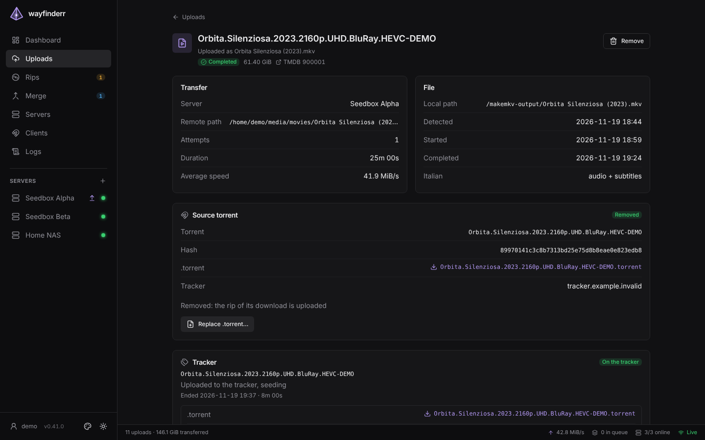

## Servers

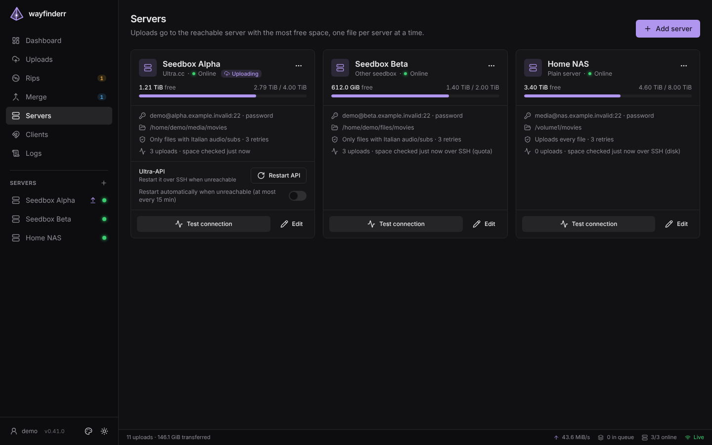

1. **Servers** → **Add server**
2. Pick the **server type**:
   - **Ultra.cc**: its free space comes from the Ultra-API (over SSH while the API does not answer)
   - **Other seedbox** (Whatbox, Feral…) or **Plain server** (VPS, NAS, a machine on the LAN): no API, the free space is read over SSH (the account quota, else the disk of the remote folder)
3. Fill in:
   - **Ultra.cc only: Username and Host** (`demo` and `alpha` for `alpha.usbx.me`): they fill in the SSH login and the **Ultra-API endpoint**, `https://user.host.usbx.me/ultra-api/get_diskquota`; add the **Ultra-API token** from the Ultra.cc [Storage/Traffic API script](https://docs.ultra.cc/unofficial-ssh-utilities/storagetraffic-api-endpoint)
   - **SSH Host / Port / Username / Password**: the SSH login (leave the password blank to use the key in `SSH_PRIVATE_KEY_PATH`)
   - **Remote Folder**: where the files go, e.g. `/home/<user>/media/movies` (created if missing)
   - **Media Policy**: skip files without Italian audio/subs, or always upload
4. Click **Test**: it reads the free space (the API, or over SSH) and checks the SSH/SFTP login
5. Repeat for every server

From now on every new `.mkv` in the watch folder, subfolders included, is uploaded automatically. A file is picked up once its size has been stable for 30 seconds. The folder is also rescanned every 30 seconds, so files the watcher misses (it can happen on Docker Desktop and network shares) are still picked up, within a minute or two. With `DELETE_AFTER_UPLOAD=true` the local file is deleted once it is on the server.

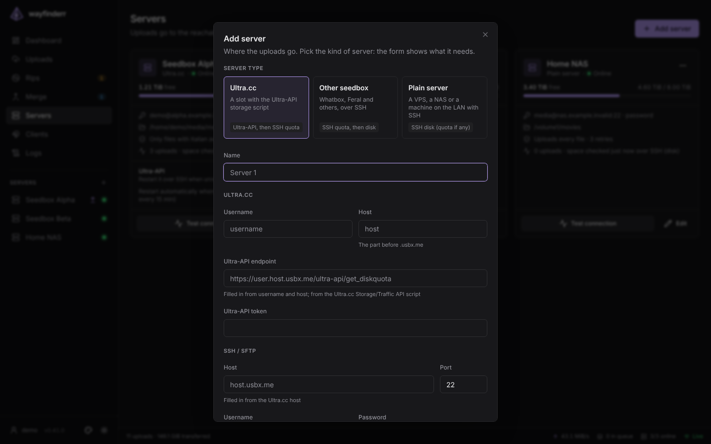

**SSH host key:** at the first connection Wayfinderr keeps the server's host key (its `SHA256:…` fingerprint, shown under the SSH login when you edit the server) and checks it at every other one: a server answering with another key gets neither the password nor any file, and the upload, the test or the release fails with `SSH host key of … changed`. If the server was reinstalled, **Forget** the key there: the next connection keeps the new one. Changing the host or the port forgets it too. The same goes for the machine of a client's local release (**Clients** → edit the client).

Every server card shows its free space and where it was read (the API, or over SSH: the account quota or the disk), and, for an Ultra.cc slot, a **Restart Ultra-API** entry (it can also restart itself when the API stops answering).

## Automatic ripping

For films downloaded as discs: every `.iso`, Blu-ray folder (`BDMV`) or DVD folder (`VIDEO_TS`) that finishes downloading is ripped to MKV and uploaded.

1. In `.env`: `RIP_ENABLED=true`, `DOWNLOADS_DIR` (the torrent client's download folder), `TMDB_API_KEY` ([themoviedb.org](https://www.themoviedb.org/settings/api) API key or read access token) and `MAKEMKV_KEY` (your registration key, or `BETA`).
2. Start the MakeMKV service too: `docker compose --profile makemkv up -d`. Its image, `wayfinderr-makemkv`, is [jlesage/makemkv](https://github.com/jlesage/docker-makemkv) (web GUI on port 5800) plus a runner that executes the rips Wayfinderr asks for.

For each disc Wayfinderr:

1. waits until the download is complete (no `.!qB`/`.part` files, nothing changed for `RIP_QUIET_MINUTES`);
2. reads its titles (`makemkvcon info`);
3. finds the film on TMDB from the download name (title and year), or from the disc label;
4. picks the film's title: the only one at least `RIP_MIN_LENGTH` long (45 minutes; shorter extras are ignored);
5. rips it keeping video, audio and subtitles in Italian and in the film's original language (Italian first); when the disc has no audio in the original language but has some in another one (an anime dubbed in English), it asks which one to keep in its place;
6. moves it to the watch folder as `Title (Year).mkv`, with the Italian TMDB title: the upload follows.

With merging on (`MERGE_ENABLED`, see *Merge with Dyadrr*), a disc without Italian is ripped too, as the better video of a merge: it keeps the original language and English (Dyadrr measures the sync on a language both files have), and its file is held for the merge.

It never guesses: when a disc has more than one long title (several films or cuts) and more than one of them (or none) has Italian audio, many look-alike playlists, no Italian track (with merging off), no audio in the original language (*Choose…* → *Second language*), more discs in the same download, an unsure TMDB match, or there is not enough space, the rip stops on **Rips** → *Needs attention*: *Choose…* the title and/or the film there and it goes on. A film TMDB doesn't know can be ripped all the same: it keeps every language and is named after the download. When the backend starts, the rips still waiting for their film are looked up on TMDB again (and again 10 minutes later if TMDB does not answer), so an update that recognizes more titles also applies to them: the ones identified go on by themselves, or wait only for the title choice. Downloads already in the folder the first time are listed as skipped (*Rip anyway* from the page, or `RIP_EXISTING=true`).

A film already ripped can be ripped again while its disc is still in the downloads (after a change to the tracks kept, for instance): the rip's menu → *Rip again…* rips the same title as the same film with the current settings. The earlier file in the watch folder is deleted right away; the new one gets the same name, and its upload replaces the copy on the server. A joined film is ripped again from every disc and joined again. Not while its upload is still running.

If the torrent client keeps the downloads in progress in a folder inside the downloads (e.g. qBittorrent's *Keep incomplete torrents in* `/downloads/torrents`) and moves them to the downloads folder once complete, pick that folder in **Rips** → *Exclusions* → *Ignored folders*: it is never searched, and the discs listed from it leave the list. Tick *Downloads arrive complete* too: what appears in the downloads is then handled within a minute or two instead of waiting `RIP_QUIET_MINUTES` without changes.

To keep some discs from being ripped (TV series, extras discs...), add rules in **Rips** → *Exclusions*: a disc whose path in the downloads contains one of them (`Serie TV/`, `S0*E`; `*` matches any text, case doesn't matter) is listed as skipped. The dialog shows which discs each rule matches. A new rule also skips the discs not ripped yet; removing it puts back in the queue the discs it skipped.

The rips run one at a time inside the MakeMKV container; Wayfinderr only exchanges small job files with it in `<watch folder>/.wayfinderr`. Set the MakeMKV container's `USER_ID`/`GROUP_ID` to the owner of the watch folder: at start it takes ownership of `/output` if it cannot write there.

### RAR archives

RAR archives in the downloads (`.rar`, `.part1.rar` + `.part2.rar`..., `.rar` + `.r00`...) are unpacked with `unrar` (included in the Docker image; for a local run install it, or set `UNRAR_PATH`, e.g. `C:/Program Files/WinRAR/UnRAR.exe`). Once the download is complete, Wayfinderr lists the archive without unpacking it:

- one film inside, a disc (ISO, `BDMV`, `VIDEO_TS`) or an `.mkv` (samples aside): it is unpacked;
- nothing else is handled: an archive without a film (subtitles, extras), with several films, password-protected or holding links is listed as skipped, with the reason.

**Where it is unpacked.** Wayfinderr checks the free space of the disk holding the downloads and of the one holding the watch folder, and unpacks the archive on the one with more space left afterwards (2 GB always stay free). A disc unpacked next to the watch folder counts twice there, since its rip goes there too. Without room on either disk the archive stops on *Needs attention* with the free space of each: free some space, then *Retry*.

- Next to the downloads: `<downloads>/.wayfinderr/unpack/`. With Docker the downloads are read-only for the backend except this folder, mounted writable by `docker-compose.yml`; without that line archives are only unpacked next to the watch folder (the Rips page tells which disks are used).
- Next to the watch folder: `<watch folder>/.wayfinderr/unpack/`.

**Then:**

- a disc is ripped like any other (MakeMKV reads it where it was unpacked); the unpacked copy is deleted once the rip is done;
- an `.mkv` is named `Title (Year).mkv` like a rip (TMDB title, or the download name). Unpacked next to the watch folder, it is moved there and uploaded like any other file. Unpacked next to the downloads, it is uploaded from there (moving it would mean copying it to the other disk) and deleted once on the server, or skipped by the server's media policy, or when its upload is deleted; until then a failed or stopped upload can be retried.

Archives are unpacked one at a time, between rips. *Skip* stops an unpacking and deletes what was unpacked. Archives already in the downloads when this was added are listed as skipped (*Rip anyway*, or `RIP_EXISTING=true`). To never unpack them, add the exclusion rule `.rar`.

### Rip without MakeMKV

When MakeMKV can't rip a disc (makemkvcon crashes, the `BETA` key expired, the runner is offline), **Rips** → the rip's menu → *Rip without MakeMKV* rips it with the backend's own tools instead, included in the Docker image:

| Disc | Tool | Notes |
|---|---|---|
| Blu-ray folder (`BDMV`) | `mkvmerge` on the film's playlist (`.mpls`) | joins its clips; languages from `CLIPINF`, chapters from the playlist |
| Blu-ray `.iso` | the playlist's files extracted with 7-Zip (`7zz`), then `mkvmerge` | needs twice the film's size free on the watch folder disk |
| DVD (`VIDEO_TS` or `.iso`) | `ffmpeg` (`dvdvideo` input, ffmpeg 7+ built with libdvdnav) | languages, subtitles (VobSub) and chapters from the IFO files |

The disc's titles are read again without MakeMKV (a Blu-ray title is its playlist number, e.g. *Title 800* is `00800.mpls`; a DVD title is the DVD's own), then the rip goes on as usual: the film's title is picked automatically or chosen in *Choose…* (a Blu-ray title already chosen on MakeMKV's scan is kept), the tracks kept are the same (Italian first and default, plus the original language) and the file is moved to the watch folder as `Title (Year).mkv`. *Retry with MakeMKV* goes back to MakeMKV.

Limits: nothing is decrypted, so only unencrypted discs work (as downloaded discs usually are); a Blu-ray played through several angles keeps the first one, 3D keeps only the 2D picture, and forced subtitles are not told apart. Neither tool reports a damaged download, so the playlist's clips must all be there and whole, and the ripped file must be as long as the title: a missing or cut clip fails the rip with the reason. A damaged chunk inside a clip goes unnoticed (that part of the film is skipped). Running locally (no Docker), install MKVToolNix, 7-Zip and ffmpeg 7+, or set `MKVMERGE_PATH`, `SEVENZIP_PATH`, `FFMPEG_PATH`, `FFPROBE_PATH`; the Rips page shows which discs can be ripped without MakeMKV.

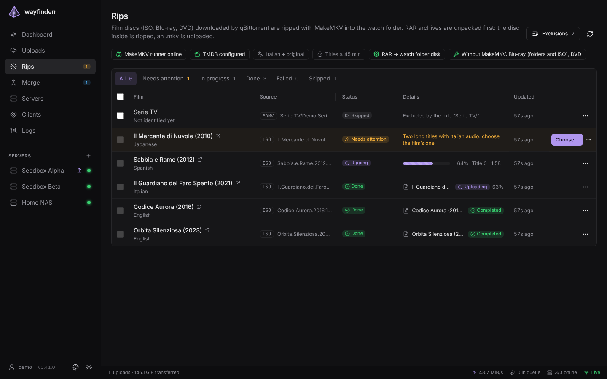

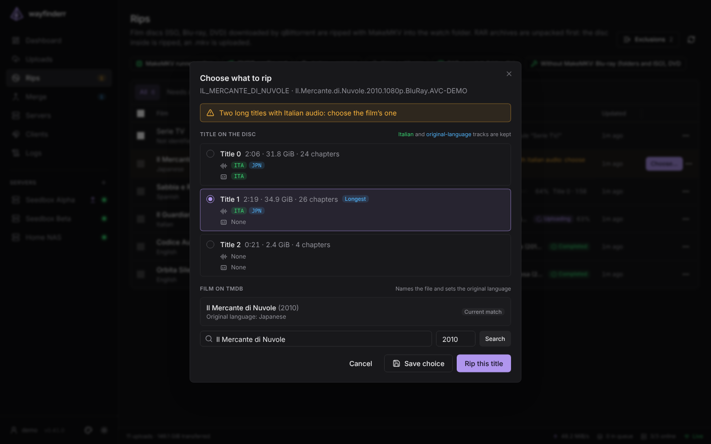

## Remove the source torrent

If the films come from qBittorrent, Wayfinderr can remove each torrent once its MKV is uploaded.

1. In qBittorrent enable the WebUI (Tools → Options → WebUI). Optional: put the disc torrents in a category such as `rip`
2. Open **Clients** → **Add client**: URL (`http://localhost:8080`; from Docker `http://host.docker.internal:8080`), username/password (or an API key on qBittorrent 5.2+, or blank if the WebUI skips login for this host), category, and whether to keep or delete the downloaded files
3. Click **Test connection**
4. For MKVs not ripped by Wayfinderr, set `TMDB_API_KEY` (the ripper's key, see above) so that `LA_CITTA_SOMMERSA_t00.mkv` matches `The.Sunken.City.2019.1080p.BluRay`

How a torrent is matched and removed:

- **Its .torrent sent beforehand** (by [bookrr](https://github.com/TehMaat/bookrr), or added in **Clients** → *Source .torrent files*): copied into the upload as soon as the rip of its download is done, the torrent is the one with that very info hash, whatever client it is in. See below
- **Ripped by Wayfinderr** (automatic ripping above): the torrent is the one whose folder or file is the rip's download, an exact match whatever the names. With several discs in one download, it waits for all of them
- **Any other MKV**: the MKV name and its folders inside the watch folder (`_t00`, `DISC_1`, release tags and the leading article are ignored) are compared with every finished torrent's name, content folder and TMDB titles. Generic names such as `title_t00.mkv` never match: rename the file or rip into a folder named after the movie
- **Automatic** only when it is 100% the torrent: the rip's download, or for a name match the very same title (score 100) with a year in both the MKV name (file or folder, e.g. `La città sommersa (2019)`) and the torrent (its name, or its TMDB film) that agrees, and no other torrent matching at all. Anything less (`Sunken City` vs `Sunken City 2`, `LA_CITTA_SOMMERSA_t00.mkv` with no year, the title spelled differently, two torrents of the same movie) only shows a suggestion and a **Remove torrent now** button on the upload page
- The removal waits 5 minutes, then until no other rip or upload of the same download is still running (for an MKV matched by name: no other MKV of the same film queued or uploading, and no MKV in the watch folder written in the last 2 minutes, since MakeMKV may still be ripping the other titles from that ISO)
- Only finished torrents are ever considered. Note that removing a torrent stops seeding: on private trackers check your ratio rules, or leave **When matched** on "Only suggest"

## Source .torrent files from bookrr

[bookrr](https://github.com/TehMaat/bookrr) can send the source torrent's .torrent of a film it downloaded, so that the upload keeps it (to download it again) without adding it by hand:

1. Account menu (your username at the bottom of the sidebar) → **API key** → copy it
2. In bookrr, give that client the address of Wayfinderr and the key

Once the download is complete bookrr sends the .torrent (`POST /api/source-torrents`); Wayfinderr keeps it and copies it into the upload as soon as the rip of that download is done (the rip's download has the torrent's name), or when a file in the watch folder sits under that name. **Clients** → *Source .torrent files* lists them (with the ones still waiting for their rip), downloads and deletes them, and takes .torrent files by hand too. They are kept for good. With a merge, each of the two files gets its own; the merged file's page shows both.

The API key works for every API: keep it secret, and regenerate it from the same dialog if it leaks.

## Release on the tracker

A completed upload can be released on a tracker from the server it is on: the **Tracker** card of the upload proposes a release name from its media info (`NAME.YEAR.RESOLUTION.AUDIO.SUBS-TAG`, editable), renames the file on the server into `<release folder>/<name>/<name>.mkv`, then runs the server's **tracker command** there over SSH inside `tmux`, so it survives a dropped connection or a restart of Wayfinderr. The card follows its output live and answers its questions (the TMDB id, a duplicate, a trailer); once it is done it keeps the `.torrent` the tracker gave back.

Once the tracker accepts it (on a server or locally, the first run or a run again), Wayfinderr checks where the file is now, by its exact size: where it was released, else in the release and upload folders (as **Link** does). If the tracker command moved it, the **Remote path** follows it and the log says `Release moved by the tracker command: <old> → <new>`; if it is nowhere, the path is kept and the file shows as missing. An SSH error changes nothing. Besides the rename and **Link**, which set the path where they just moved or found the file, this is the only time it is checked: never at start, never on a timer.

Set it per server in **Servers** → edit: the release folder, the release tag (`-TAG` at the end of the name) and the tracker command (e.g. `uploader -u {path}`; `{path}`, `{folder}` and `{name}` are replaced). With **After each upload** → *Ask for the release name right away*, the card asks right after every upload. The server needs `tmux` and `bash`. See the [Release API](API.md#release-api) for every detail.

## Release locally

With room on this machine, a file can be released from the qBittorrent client here instead of being uploaded to a server: the same rename and tracker command as on a server (the **Tracker** card), run over SSH on the machine qBittorrent runs on.

1. On that machine: an SSH login, `tmux`, and the tracker upload command set up to seed in this qBittorrent. The command gives qBittorrent the folder of the file as it sees it, so qBittorrent must see the release folder at the same path: with qBittorrent in Docker, mount it there too (e.g. `- /mnt/data/downloads/releases:/mnt/data/downloads/releases`); if the uploader can put every release in one fixed folder (`SHARED_QBIT_PATH` in Unit3Dup-style uploaders), turn that off (`no_path`)
2. **Clients** → edit the client → **Local release** on: SSH host (from Docker, the host's address on the Docker network) and login, the **watch folder** as that machine sees it (e.g. `/mnt/data/extracted-mkv` for a container's `/makemkv-output`), the **release folder** (e.g. `/mnt/data/downloads/releases`, a folder qBittorrent sees too), the release tag and the tracker command (e.g. `uploader -u {path}`). The watch folder and the release folder must be on the same disk: the file is moved, not copied
3. **Test connection** also checks the SSH login, both folders, tmux and the command

Then **Release locally…** shows in the menu of an upload not on a server yet (queued, uploading, failed, skipped or stopped) and in its **Tracker** card: the upload stops, the file is moved into `<release folder>/<name>/<name>.mkv` on that machine and the tracker command uploads it and seeds it there. The upload then counts as completed (on the client, "qBittorrent (local)"), and its source torrent is cleaned up as after an upload. The torrent of a release, local or on a server, seeds for good: the torrent cleanup never takes it for a source torrent and never removes it, not even by hand. To merge a film released locally later (a better video arriving), mount the release folder with `SEEDING_DIR`.

## Merge with Dyadrr

[Dyadrr](https://github.com/TehMaat/dyadrr) merges two rips of the same film into one file: the better video (a foreign UHD, say) with the Italian audio and subtitles of the other (the Italian Blu-ray), lined up and added without re-encoding. It runs in its own container; Wayfinderr hands it jobs through the watch folder.

1. In `.env`: `MERGE_ENABLED=true` (needs `RIP_LANGUAGE=it`: Dyadrr only works with Italian).
2. Start the Dyadrr service too: `docker compose --profile merge up -d`. Its image is `ghcr.io/tehmaat/dyadrr` (`DYADRR_TAG`, `latest` by default).

With merging on, a new file in the watch folder can be **held** instead of uploaded, so both files of a pair are still on the disk when they are merged:

- a file **without Italian audio** is always held: it may be the better video of a merge (it would otherwise be skipped, or uploaded without Italian);
- a file **with Italian audio** is held when a **twin** of the same film is around, certain or doubtful: a held file without Italian, a rip not finished yet, or a torrent of the download clients (downloading or not; the one the file was ripped from left out). Names are compared against every TMDB title of the film (translations, alternative titles), so the Italian Blu-ray of *Notte sul Lago Ferro* finds the German UHD `Nacht.am.Eisensee.1998`. A download client that cannot be reached counts as a doubt too;
- with no twin it is uploaded as before.

A twin torrent that is the **release of a film Wayfinderr already sent** (by its info hash, or for a local release by its name on that client) is that film: the hold names it, says whether it has the Italian audio, and whether it can be paired where it seeds. That is the usual upgrade: the 1080p disc with Italian was ripped and released locally, now the UHD without Italian arrives, *Its twin may be the file "Notte sul Lago Ferro (1998).mkv" (with Italian audio), released locally and seeding as "Lago.Ferro.1998.1080p.REMUX-NOI.mkv" in qBittorrent: it can be paired where it seeds*.

**Holding by hand.** When Wayfinderr cannot tell on its own (the other torrent is not in the client yet, its name says nothing, the second disc is ripped later), say it yourself:

- **Hold for merge** in an upload's menu, or on its page, for a file not on a server yet (pending, queued, failed, skipped or stopped): it leaves the upload queue and is held (*Held by hand*). Once it is uploading, stop it first;
- **Hold for merge** in a rip's menu, at any time before it is done (also while the torrent is still downloading): its file is held as it arrives, without looking for a twin, every part of a join and the `.mkv` of an archive included. The rip shows a *Hold* badge;
- **Hold every new file**, the switch on the **Merge** page: while on, everything that arrives is held. Rough, but handy while many films to merge come in;
- **Plan a pair…** on the **Merge** page: two downloads, among the rips not finished, the torrents of the clients and the files not uploaded yet, that will become a pair. Each file is held as it arrives (*Planned pair*); once both are there the pair is created and analyzed on its own. The confirmation before the merge stays. bookrr does the same through the API when it sends the two torrents of a merge (`POST /api/merge/plans`, with the API key, see [API.md](API.md#planned-pairs)), by their info hashes.

A held file is never uploaded, deleted, released locally, cleaned up with its archive or its torrent, until you choose on the **Merge** page, or on its upload page: **Pair…**, **Upload as it is** (the server's media policy still applies) or **Delete file…**. Leaving it there waits for the twin, with no time limit. The page and the upload say why it was held, and which twin was found. **Held for a merge** (and the count next to **Merge** in the sidebar) lists only the held files not in a pair: once paired, a file is followed on its pair's card, and comes back to the list when the pair is removed (trash icon). Deleting a held file removes its pairs too, except a merged one.

**Pairing and analysis.** **Pair…** on a held file (or **Pair files…** at the top of the page) pairs it with its twin: any two files still on the disk and not being uploaded, held or not; the likely twin is listed first. A film **released locally** is there too, with a *seeding* badge, when its release folder is mounted (`SEEDING_DIR`, [Configuration](CONFIGURATION.md#docker-compose)): Dyadrr reads it where it seeds, read only. It is never moved or deleted, its upload stays completed after the merge, and its torrent keeps seeding. Dyadrr tells which one is the better video and which one the Italian file, and runs its analysis in its container: it measures how the Italian lines up with the video along the whole film, without writing anything. The page follows it live, then shows what it found: the offset, how much of the film the two files have in common, where the Italian audio goes, the Italian tracks, the warnings, and the choices still to make with what each value would do; or why the pair was refused (`CHECKPOINT_CONTRADICTION`, `LOW_COVERAGE`...), with Dyadrr's full report a click away. On a pair Dyadrr is not running (ready, refused, failed or stopped), each held file of it has its own line at the bottom of the card, with what it could do in the list: **Pair with another…**, **Upload as it is**, **Delete file…**. In **Pair…**, a file already paired with the first one is marked: *Refused* with Dyadrr's code (and listed last), or the pair's status. Choosing it does not pair the two files twice: their pair is analyzed again (**Analyze again**), with the original language typed in, or the one it had. The original language (the sync is measured on it when both files have it, else on English) comes from the rip or TMDB, or is typed in. A file being analyzed cannot be uploaded or deleted until it ends or is stopped.

**Merge.** **Merge…** on a pair that can be merged asks the choices left pending (each with what it does) and the merged file's name: the film's usual name (the rip's `Title (Year)`, else its TMDB title, else the better video's file name), in the watch folder. When a file with that name is already in the watch folder or on a server, it asks whether to replace it (the local file is deleted, the upload replaces the one on the server) or stop to check. Dyadrr then checks that nothing changed since the analysis (`--expect`), merges without re-encoding and verifies the result; the page follows it live. The merged file goes to the upload queue like any rip (never held); the two files become **Merged**, and are kept or deleted as set in **Choices** (only the ones in the watch folder: the downloads belong to the torrent client, and a film released locally seeds on); once the merged file is on a server, the source torrents of both are cleaned up. A merge stopped or failed (`NO_SPACE`, `INPUT_CHANGED`, `VERIFY_FAILED`...) is not a refusal: the pair stays mergeable, with the reason, to merge again. Only one thing writes a film at a time: a merge waits for the rip, unpacking or join in progress to end (*Waiting for the rip in progress to end*), and the next rip waits for the merge, since neither counts the space the other is about to use.

**Choices.** Some pairs need a decision (Dyadrr's *scelte*): the Italian past the end of the video (cut or keep), which Italian audio tracks (all or the main one), Italian PGS already in the better video (keep or drop), the Italian over a different intro or ending (leave out or keep). **Choices** sets each one to a fixed value, passed to every analysis, or to *Ask each time* (the default): the analysis then leaves it pending and shows what each value does, and the merge asks it. It also sets what happens to the two files after a merge: kept (the default) or deleted.

The `dyadrr` service mounts the watch folder writable as `/data/watch` (the job files in `<watch folder>/.wayfinderr/dyadrr/jobs`, the merged film and Dyadrr's temporary files) the downloads read-only as `/data/downloads` and the release folder of the local releases read-only as `/data/seeding`. It keeps the fixed host name `dyadrr`: Dyadrr recognizes its own temporary files by host name, so the ones left by a job stopped abruptly are removed by the next job only if the name stays the same. Only one Dyadrr container per watch folder.

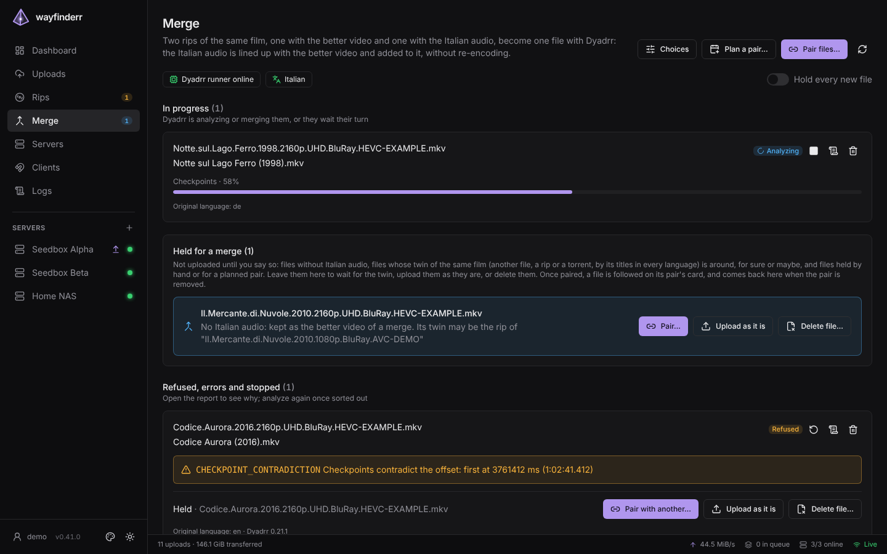

## Logs

What Wayfinderr and Dyadrr did, kept on disk in the data volume (`/app/data/logs`, one file a day): the backend, the Dyadrr runner, and every analysis and merge, phase by phase. Filter by source, level, text and day, and download what you see. A merge pair's page shows its own lines. With merging on, the backend also says at start whether the release folder of the local releases is mounted and how many films released locally it finds there, and why a film released locally is left out of **Pair…** (see [Troubleshooting](TROUBLESHOOTING.md#torrent-cleanup-and-release)). How long they are kept: `LOG_RETENTION_DAYS` and `LOG_MAX_SIZE_MB` ([Configuration](CONFIGURATION.md#logs)).

## Look and feel

The sun/moon button at the bottom of the sidebar switches between the dark and the light theme; the palette button picks one of five accent colors (violet, red, blue, green, amber), also used for the browser tab icon. Both are kept in this browser.

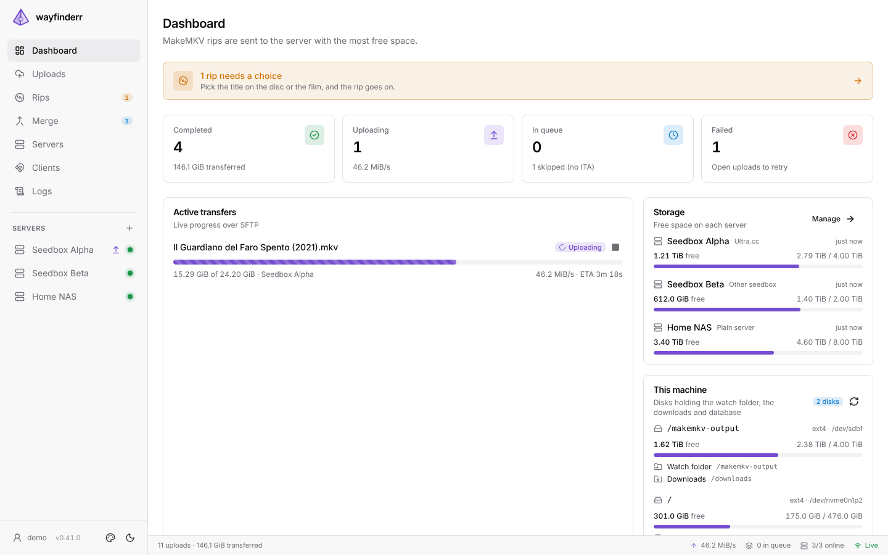
